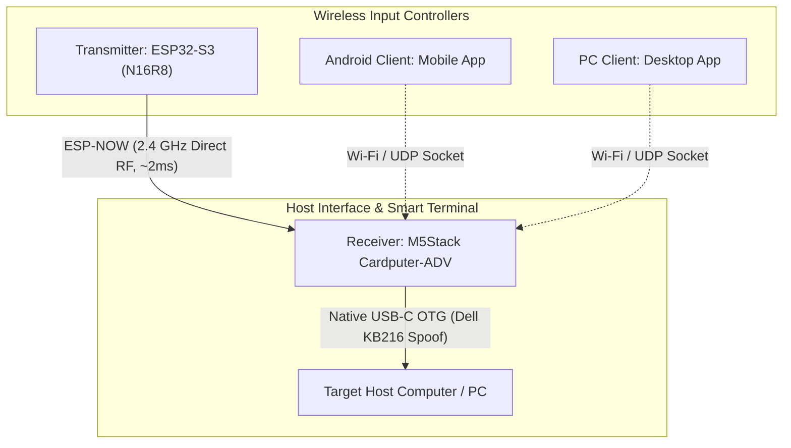

# Cardputer-KVM

A high-performance, ultra-low-latency wireless KVM (Keyboard-Video-Mouse / Controller) ecosystem built with Espressif ESP32 hardware and cross-platform companion clients.

The **M5Stack Cardputer-ADV** serves as the **Host KVM Receiver**, spoofing an authentic USB HID peripheral directly into the target computer while displaying live telemetry on its color LCD. Remote input is beamed wirelessly from dedicated transmitters, Android smartphones, or desktop companion apps over **ESP-NOW 2.4 GHz RF** (~2–5 ms latency).



---

## System Architecture & Component Roles

| Directory | Target Hardware / Platform | Role & Primary Responsibilities |
| :--- | :--- | :--- |
| **[`receiver/`](receiver/)** | **M5Stack Cardputer-ADV** | **Smart KVM Host Receiver:** Plugs into the target PC via USB-C. Emulates an authentic **Dell KB216 Wired Keyboard** (`0x413C:0x2113`). Features a 1.14" ST7789 display for live USB & RF link monitoring, battery level, plus an onboard physical 56-key console override. |
| **[`transmitter/`](transmitter/)** | **ESP32-S3 N16R8** | **Wireless Remote Transmitter:** Captures user keystrokes / controls and beams low-latency 6KRO HID packets over **ESP-NOW**. Includes an interactive terminal bridge: typing in serial monitor beams keystrokes directly to the target PC! |
| **[`android-client/`](android-client/)** | Android Mobile OS | **Mobile Controller App:** Virtual touchpad, soft keyboard, shortcut macros, and remote control over Wi-Fi/BLE. *(In development)* |
| **[`pc-client/`](pc-client/)** | Linux / Windows Desktop | **Desktop Companion Console:** Remote input streaming, clipboard sharing, and macro relay. *(In development)* |
| **`esp-sdk/`** | Local ESP-IDF v5.3 Framework | Local ESP-IDF toolchain repository used to compile both embedded targets. |

---

## Key Features

* **Authentic USB Peripheral Spoofing:**
  * Target host identifies device as an authentic **Dell KB216 Wired Keyboard** (`VID: 0x413C`, `PID: 0x2113`).
  * 100% driverless plug-and-play compatibility across Linux, Windows, macOS, and BIOS/UEFI boot menus.
* **Ultra-Low Latency Wireless Link (ESP-NOW):**
  * Operates on **2.4 GHz Channel 1** with zero-config auto-pairing (broadcast `FF:FF:FF:FF:FF:FF`).
  * Near-instant packet transmission (~2–5 ms), supporting fast typing, key holds, and key combinations.
* **On-Screen Receiver Dashboard:**
  * Cardputer-ADV's 1.14" ST7789 color LCD displays real-time connection state (`USB: CONNECTED`), active RF link (`RF: LINKED [MAC]`), battery level, and live keypress history.
* **Dual Local & Remote Input:**
  * The Cardputer-ADV's physical 56-key matrix (scanned via TCA8418 I²C controller) acts as a local emergency keyboard right at the target machine while simultaneously receiving remote wireless input.
* **Interactive Terminal Console Bridge:**
  * The transmitter firmware features an interactive serial console: characters typed into `idf.py monitor` on your development PC are read in real-time, beamed over ESP-NOW, and injected onto the target PC!

---

## Hardware Specifications

### 1. Receiver: M5Stack Cardputer-ADV
* **Microcontroller:** ESP32-S3FN8 (dual-core 240MHz, 8MB Flash).
* **Native USB-C Routing:** Wired directly to ESP32-S3 USB OTG signals (**GPIO 19 = D-**, **GPIO 20 = D+**) without intervening UART bridges.
* **Keypad Scanner:** **TCA8418 I²C controller** (`0x34`, INT on GPIO 11) with full Fn/Shift matrix decoding.
* **Display:** 1.14" ST7789 TFT LCD (240x135 SPI).
* **Framework:** M5Stack official HAL (`M5Unified`, `M5GFX`, `Adafruit_TCA8418`, `tusb_hid_device_helper`).

### 2. Transmitter: ESP32-S3 N16R8
* **Microcontroller:** ESP32-S3 (dual-core 240MHz).
* **Memory:** 16MB SPI Flash (`DIO 80MHz`) + 8MB Octal PSRAM (`OPI 80MHz`).
* **Input Interfaces:** Onboard BOOT button (GPIO 0), interactive UART0 terminal console, and expandable GPIO/ADC headers.

---

## ESP-NOW Wireless Protocol (`kvm_protocol.h`)

All communication between Transmitter and Receiver is packetized in a lightweight binary structure:

```c
#define KVM_ESPNOW_CHANNEL 1
#define KVM_ESPNOW_MAGIC   0x4B56 // "KV"

// 6KRO USB-compliant Key Packet
typedef struct __attribute__((packed)) {
    uint16_t magic;         // 0x4B56
    uint8_t  pkt_type;      // 0x01 (KVM_PKT_KEY_REPORT)
    uint8_t  modifiers;     // Bitmask: Ctrl, Shift, Alt, GUI
    uint8_t  keycodes[6];   // Active HID keycodes (e.g. 0x04 for 'a')
    uint16_t seq_num;       // Packet counter
} kvm_key_packet_t;

// Heartbeat / Link Keep-Alive Packet
typedef struct __attribute__((packed)) {
    uint16_t magic;         // 0x4B56
    uint8_t  pkt_type;      // 0x03 (KVM_PKT_HEARTBEAT)
    uint32_t uptime_ms;     // Transmitter uptime in ms
    uint16_t seq_num;
} kvm_heartbeat_packet_t;
```

---

## Quick Start & Build Instructions

### Prerequisites
Activate the local ESP-IDF toolchain from the repository root:

```bash
. ./esp-sdk/export.sh
```

---

### Step 1: Flash the Cardputer-ADV (Receiver)

Connect your Cardputer-ADV to your computer via USB-C (typically `/dev/ttyACM0`):

```bash
cd receiver
idf.py set-target esp32s3
idf.py -p /dev/ttyACM0 flash monitor
```

*The Cardputer screen will illuminate, showing `USB: CONNECTED (Dell KB216)` and `RF: ESP-NOW CH 1 (LISTENING)`.*

---

### Step 2: Flash the ESP32-S3 N16R8 (Transmitter)

Connect your ESP32-S3 N16R8 board via USB (typically `/dev/ttyUSB0` or `/dev/ttyACM1`):

```bash
cd transmitter
idf.py set-target esp32s3
idf.py -p /dev/ttyUSB0 flash monitor
```

---

### Step 3: Test End-to-End Wireless KVM

1. **Verify Link Indicator:**
   * Within seconds of powering on the transmitter, the Cardputer-ADV display will update:
     ```text
     RF: LINKED [XX:XX:XX...]
     ```
2. **Test Button Keystroke Injection:**
   * Press the **BOOT button** on the ESP32-S3 transmitter board.
   * The text `[Hello from ESP32-S3 N16R8 over ESP-NOW!]` will beam through the air and type directly into the target PC!
3. **Test Interactive Terminal Typing:**
   * In your transmitter's `idf.py monitor` terminal, start typing characters — each keypress is transmitted across ESP-NOW in real-time and typed onto the host machine!

---

## Technical Documentation
* **[CARDPUTER_ADV_RECEIVER_VERIFICATION.md](CARDPUTER_ADV_RECEIVER_VERIFICATION.md):** Verification log, kernel `dmesg` outputs, and official M5Stack HAL integration details.
* **[SYSTEM_OVERVIEW.md](SYSTEM_OVERVIEW.md):** Architectural design, topology, and hardware routing considerations.
* **[`receiver/README.md`](receiver/README.md):** Receiver firmware details and custom partition layout.
* **[`transmitter/README.md`](transmitter/README.md):** Transmitter firmware and N16R8 PSRAM configuration.
