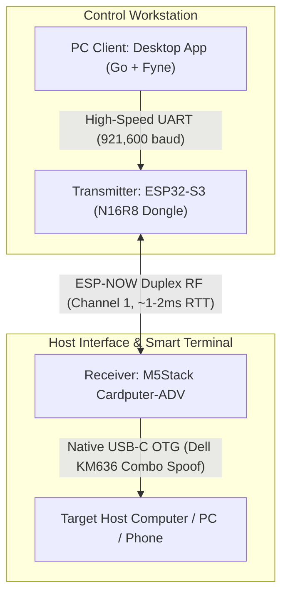

# Cardputer-KVM

A high-performance, ultra-low-latency wireless KVM (Keyboard-Video-Mouse / Controller) ecosystem built with Espressif ESP32 hardware and cross-platform companion clients.

The **M5Stack Cardputer-ADV** serves as the **Host KVM Receiver**, spoofing an authentic USB HID peripheral directly into the target computer while displaying live telemetry on its color LCD. Remote input is beamed wirelessly from dedicated transmitters, Android smartphones, or desktop companion apps over **ESP-NOW 2.4 GHz RF** (~2–5 ms latency).



---

## System Architecture & Component Roles

| Directory | Target Hardware / Platform | Role & Primary Responsibilities |
| :--- | :--- | :--- |
| **[`receiver/`](receiver/)** | **M5Stack Cardputer-ADV** | **Smart KVM Host Receiver:** Plugs into the target PC via USB-C. Emulates an authentic **Dell Wireless Keyboard & Mouse Combo** (`0x413C:0x2501`). Features a 1.14" ST7789 display for live USB status (with suspend detection), RF link state (`STANDBY`/`READY`/`ENGAGED`), battery gauge, and physical 56-key console override. Transmits live telemetry back to the transmitter. |
| **[`transmitter/`](transmitter/)** | **ESP32-S3 N16R8** | **Wireless Remote Transmitter Dongle:** Connects to PC via USB at 921,600 baud. Beams low-latency 6KRO keyboard and 125Hz mouse packets over **ESP-NOW**. Features intelligent heartbeat arbitration (standby beacon when PC app is closed, auto-yielding when PC app is active) and bidirectional UART-to-RF telemetry forwarding. |
| **[`pc-client/`](pc-client/)** | Linux Workstation | **Desktop Companion GUI:** Native Go + Fyne hardware KVM switcher. Linux kernel `evdev` grabbing (`Scroll Lock` hotkey), Scroll Lock LED sync, Light/Dark mode, live Cardputer battery donut, animated RF heartbeat pulse, and true end-to-end RTT latency tracking. |
| **[`android-client/`](android-client/)** | Android Mobile OS | **Mobile Controller App:** Virtual touchpad, soft keyboard, shortcut macros, and remote control over Wi-Fi/BLE. *(In development)* |
| **`esp-sdk/`** | Local ESP-IDF v5.3 Framework | Local ESP-IDF toolchain repository used to compile both embedded targets. |

---

## Key Features

* **Authentic USB Peripheral Spoofing:**
  * Target host identifies device as an authentic **Dell Wireless Keyboard and Mouse Receiver** (`VID: 0x413C`, `PID: 0x2501` KM636 / KM714 Wireless Combo).
  * Composite device with dedicated Boot Keyboard and Boot Mouse interfaces (1000Hz / 1ms polling).
  * 100% driverless plug-and-play compatibility across Linux, Windows, macOS, Android, and BIOS/UEFI boot menus.
* **Ultra-Low Latency Duplex RF Link (ESP-NOW):**
  * Operates on **2.4 GHz Channel 1** with automatic peer registration.
  * Near-instant packet transmission (~1–2 ms RTT latency).
  * Supports full 6KRO keystrokes, modifier combinations, mouse cursor movements, wheel scrolling, and button clicks.
* **Bi-Directional Telemetry & Proof-of-Life:**
  * Cardputer measures its own battery percentage and voltage (ADC1) and beams it back to the PC client.
  * Measures RF signal strength (RSSI) and physical Target Host USB connection status.
  * PC client displays true round-trip time (RTT) latency via sequence echoing.
* **Intelligent Heartbeat Arbitration & Receiver Display:**
  * Transmitter emits idle beacons (`host_status = 0x00`) when the PC app is closed (`RF:STANDBY` on Cardputer LCD).
  * PC app takes over when launched (`RF:READY` or `RF:ENGAGED` with animated beating heart on Cardputer LCD).
* **Dual Local & Remote Input:**
  * The Cardputer-ADV's physical 56-key matrix (scanned via TCA8418 I²C controller) acts as a local emergency keyboard right at the target machine while simultaneously receiving remote wireless input.

---

## ESP-NOW Wireless Protocol (`kvm_protocol.h`)

All communication between Transmitter and Receiver is packetized in a lightweight binary structure:

```c
#define KVM_ESPNOW_CHANNEL 1
#define KVM_ESPNOW_MAGIC   0x4B56 // "KV"

// Packet Types
#define KVM_PKT_KEY_REPORT    0x01
#define KVM_PKT_MOUSE_REPORT  0x02
#define KVM_PKT_HEARTBEAT     0x03
#define KVM_PKT_TELEMETRY     0x06

// 6KRO USB Keyboard Packet (11 bytes)
typedef struct __attribute__((packed)) {
    uint16_t magic;         // 0x4B56
    uint8_t  pkt_type;      // 0x01
    uint8_t  modifiers;     // Bitmask: Ctrl, Shift, Alt, GUI
    uint8_t  keycodes[6];   // Active HID keycodes
    uint16_t seq_num;
} kvm_key_packet_t;

// Relative Mouse Report Packet (10 bytes)
typedef struct __attribute__((packed)) {
    uint16_t magic;         // 0x4B56
    uint8_t  pkt_type;      // 0x02
    uint8_t  buttons;       // Bitmask: Left, Right, Middle
    int8_t   dx;            // X delta
    int8_t   dy;            // Y delta
    int8_t   wheel;         // Vertical wheel delta
    int8_t   pan;           // Horizontal pan delta
    uint16_t seq_num;
} kvm_mouse_packet_t;

// Duplex Heartbeat Packet (10 bytes)
typedef struct __attribute__((packed)) {
    uint16_t magic;         // 0x4B56
    uint8_t  pkt_type;      // 0x03
    uint8_t  host_status;   // 0x00=STANDBY, 0x01=CONNECTED, 0x02=ENGAGED
    uint32_t uptime_ms;     // Transmitter uptime
    uint16_t seq_num;       // Monotonic sequence number
} kvm_heartbeat_packet_t;

// Return Telemetry Packet (12 bytes)
typedef struct __attribute__((packed)) {
    uint16_t magic;         // 0x4B56
    uint8_t  pkt_type;      // 0x06
    uint8_t  battery_pct;   // 0-100%
    uint16_t battery_mv;    // Battery voltage in mV
    int8_t   rssi;          // Received signal strength in dBm
    uint8_t  usb_mounted;   // 1 = Target host USB active, 0 = Unplugged/idle
    uint16_t echo_seq;      // Echoed seq_num for RTT measurement
    uint16_t seq_num;
} kvm_telemetry_packet_t;
```

---

## Quick Start & Build Instructions

### Prerequisites
Activate the local ESP-IDF toolchain from the repository root:

```bash
. ./esp-sdk/export.sh
```

---

### Step 1: Flash the Cardputer-ADV (Receiver)

Connect your Cardputer-ADV to your computer via USB-C (typically `/dev/ttyACM0`):

```bash
cd receiver
idf.py set-target esp32s3
idf.py -p /dev/ttyACM0 flash monitor
```

*The Cardputer screen will illuminate, displaying `USB` status badge, battery level, and `RF SCAN`.*

---

### Step 2: Flash the ESP32-S3 N16R8 (Transmitter)

Connect your ESP32-S3 N16R8 board via USB (typically `/dev/ttyUSB0` or `/dev/ttyACM1`):

```bash
cd transmitter
idf.py set-target esp32s3
idf.py -p /dev/ttyUSB0 flash monitor
```

---

### Step 3: Launch the PC Client GUI

On your Linux workstation:

```bash
cd pc-client
go run .
# Or build a standalone binary:
go build -o cardputer-kvm .
sudo ./cardputer-kvm
```

Press **`[Scroll Lock]`** on your physical keyboard to lock input onto the target machine. Press **`[Scroll Lock]`** again to return to your local workstation.

---

## Hardware Compatibility Notes (USB-C to USB-C Cables)

> [!WARNING]
> **Connecting to Smartphones or PD Chargers via USB-C to USB-C:**
> The M5Stack Cardputer (M5Stamp-S3 module) has its `CC1` and `CC2` Configuration Channel pins bridged on the PCB to a single resistor.
> * **Standard USB-A to USB-C cables** (e.g., from a desktop or laptop USB-A port) work **100% reliably** because 5V VBUS is provided unconditionally.
> * **USB-C to USB-C cables** connected to smartphones (Android / iPhone) or USB-PD smart chargers may fail to enumerate because the phone interprets bridged CC pins as an *Analog Audio Adapter Accessory* rather than a USB Host OTG device.
> * **Fix for Phones:** Use a standard **USB-C to USB-A OTG adapter** on the phone, connected via a standard USB-A to USB-C cable to the Cardputer. (On Android, also ensure **Settings $\rightarrow$ OTG Connection** is enabled).

---

## Technical Documentation
* **[SYSTEM_OVERVIEW.md](SYSTEM_OVERVIEW.md):** Complete end-to-end architecture, serial protocols, and telemetry pipelines.
* **[`pc-client/README.md`](pc-client/README.md):** Native Go + Fyne Desktop GUI, evdev hardware grabber, and telemetry dashboard.
* **[`receiver/README.md`](receiver/README.md):** Receiver firmware details, TinyUSB suspend detection, and M5Unified HAL.
* **[`transmitter/README.md`](transmitter/README.md):** Transmitter firmware, heartbeat arbitration, and N16R8 PSRAM configuration.
* **[CARDPUTER_ADV_RECEIVER_VERIFICATION.md](CARDPUTER_ADV_RECEIVER_VERIFICATION.md):** Hardware verification log and kernel `dmesg` outputs.
