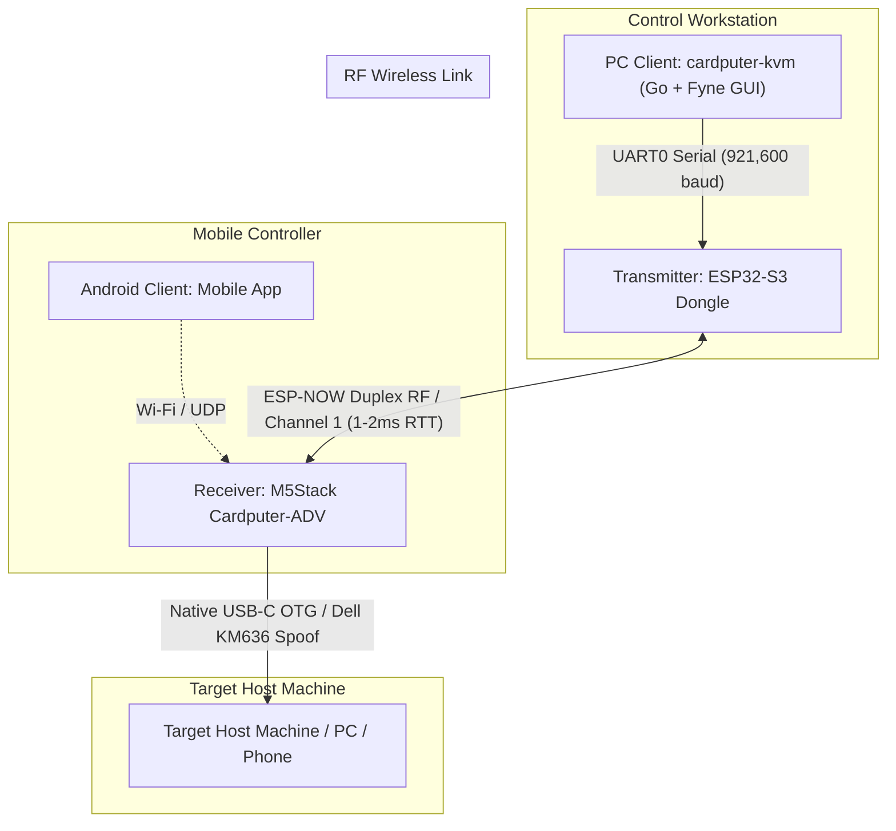

# Cardputer-KVM — System Architecture & Overview

## 1. Project Concept
**Cardputer-KVM** is a modular, ultra-low-latency wireless KVM (Keyboard-Mouse) ecosystem where the **M5Stack Cardputer-ADV** serves as the **primary KVM Receiver and Host Interface**, receiving remote input from wireless transmitters, mobile apps, and desktop clients while maintaining local console control and live bidirectional telemetry.



---

## 2. Directory Structure & Component Roles

| Directory | Target Hardware / Platform | Role & Primary Responsibilities |
| :--- | :--- | :--- |
| **`receiver/`** | **M5Stack Cardputer-ADV** | **Primary Smart KVM Receiver:** Plugs directly into the target host via USB-C. Uses ESP32-S3 native USB OTG to emulate a **Dell Wireless Keyboard & Mouse Combo** (`0x413C:0x2501`). Features a 1.14" ST7789 display for live USB status (with suspend detection), RF link state (`STANDBY`/`READY`/`ENGAGED`), battery gauge, and input telemetry. Measures and transmits live battery %, mV, and RSSI back to the transmitter. |
| **`transmitter/`** | **ESP32-S3** (N16R8 / Custom) | **Wireless Transmitter / USB Dongle:** Connects to PC via USB at 921,600 baud. Beams 6KRO keyboard and 125Hz mouse packets over **ESP-NOW**. Features intelligent heartbeat arbitration (idle standby beacon vs PC app active) and bidirectional UART forwarding of receiver telemetry. |
| **`pc-client/`** | Linux Desktop | **Hardware KVM Switch Desktop App (Go + Fyne):** Native GUI application with Linux kernel `evdev` grabbing (`Scroll Lock` hotkey), Scroll Lock LED sync, Light/Dark mode, live Cardputer battery donut gauge, animated RF heartbeat pulse dot, and true end-to-end RTT latency tracking. |
| **`android-client/`** | Android Mobile OS | **Mobile Remote Controller:** Touchpad, virtual keyboard, and remote control over Wi-Fi/BLE. *(In development)* |
| **`esp-sdk/`** | Local ESP-IDF Framework | **Toolchain & Core Framework:** Local ESP-IDF v5.3 repository used to build all embedded targets. |

---

## 3. Communication Strategy

### Primary Link: `PC Client` ↔ `Transmitter (ESP32-S3)` ↔ `Receiver (Cardputer-ADV)`
* **Workstation to Transmitter:** High-speed USB Serial UART0 at **921,600 baud**. Binary packet framing with automatic port detection and non-blocking background read loops.
* **Transmitter to Receiver:** ESP-NOW 2.4 GHz Peer-to-Peer RF (Channel 1, 12M PHY). Near-zero latency (~1–2 ms RTT), router-free, with bidirectional packet echo for live latency calculation.
* **Receiver to Target Host:** Native USB OTG emulating a Dell Wireless KM636 Keyboard and Mouse (1000Hz polling).
* **Secondary / Network Link:** Wi-Fi SoftAP / UDP sockets available for `android-client`.

---

## 4. Hardware Details

### Receiver: `M5Stack Cardputer-ADV`
* **Role:** Smart KVM Receiver, Host USB Injector & On-Desk Status Console.
* **Core:** ESP32-S3FN8 (dual-core 240MHz, 8MB Flash).
* **Native USB Advantage:** USB-C connector is wired **directly to GPIO 19 (D-) and GPIO 20 (D+)**, giving pure USB OTG functionality without intervening bridge chips.
* **USB Identity:** Spoofs a **Dell Wireless Keyboard and Mouse Receiver** (VID: `0x413C`, PID: `0x2501` KM636 / KM714 Wireless Combo).
* **Display:** 1.14" ST7789 TFT LCD (240x135 SPI) displaying live USB connection state (`USB` vs `NO USB`), RF link status (`RF:STANDBY`, `RF:READY`, `RF:ENGAGED`), animated beating heart indicator, battery gauge, and key/mouse telemetry cards.
* **Keyboard:** 56-key matrix scanned by an onboard **TCA8418 I²C controller** (`0x34`, INT on GPIO 11), providing a local physical keyboard override at the host machine.
* **Framework:** M5Stack official HAL (`M5Unified`, `M5GFX`, `Adafruit_TCA8418`, `tusb_hid_device_helper`).

### Transmitter: `ESP32-S3 N16R8`
* **Role:** Remote wireless input transmitter.
* **Core:** ESP32-S3 (dual-core 240MHz).
* **Memory:** 16MB Flash (`DIO 80MHz`) + 8MB Octal PSRAM (`OPI 80MHz`).
* **Input Interfaces:** Onboard BOOT button (GPIO 0), interactive UART0 terminal console bridge, expandable GPIO/ADC headers.
* **Wireless:** ESP-NOW 2.4 GHz RF transmitter (Channel 1, broadcast pairing).

---

## 5. Build Environment Reference

### Activate Local Environment
```bash
. ./esp-sdk/export.sh
```

### Build Receiver (Cardputer-ADV)
```bash
cd receiver
idf.py set-target esp32s3
idf.py build
idf.py -p /dev/ttyACM0 flash monitor
```

### Build Transmitter (ESP32-S3 N16R8)
```bash
cd transmitter
idf.py set-target esp32s3
idf.py build
idf.py -p /dev/ttyUSB0 flash monitor
```

---

## 6. Reference Documentation
* **[`README.md`](file:///media/thunder/LinWin/Projectos/Cardputer-KVM/README.md):** Main project landing page, architecture overview, and quick start guide.
* **[CARDPUTER_ADV_RECEIVER_VERIFICATION.md](file:///media/thunder/LinWin/Projectos/Cardputer-KVM/CARDPUTER_ADV_RECEIVER_VERIFICATION.md):** Verification log, kernel `dmesg` outputs, and HAL integration details.
* **[`receiver/README.md`](file:///media/thunder/LinWin/Projectos/Cardputer-KVM/receiver/README.md):** Receiver firmware details, partition table, and build steps.
* **[`transmitter/README.md`](file:///media/thunder/LinWin/Projectos/Cardputer-KVM/transmitter/README.md):** Transmitter firmware and N16R8 PSRAM configuration.
