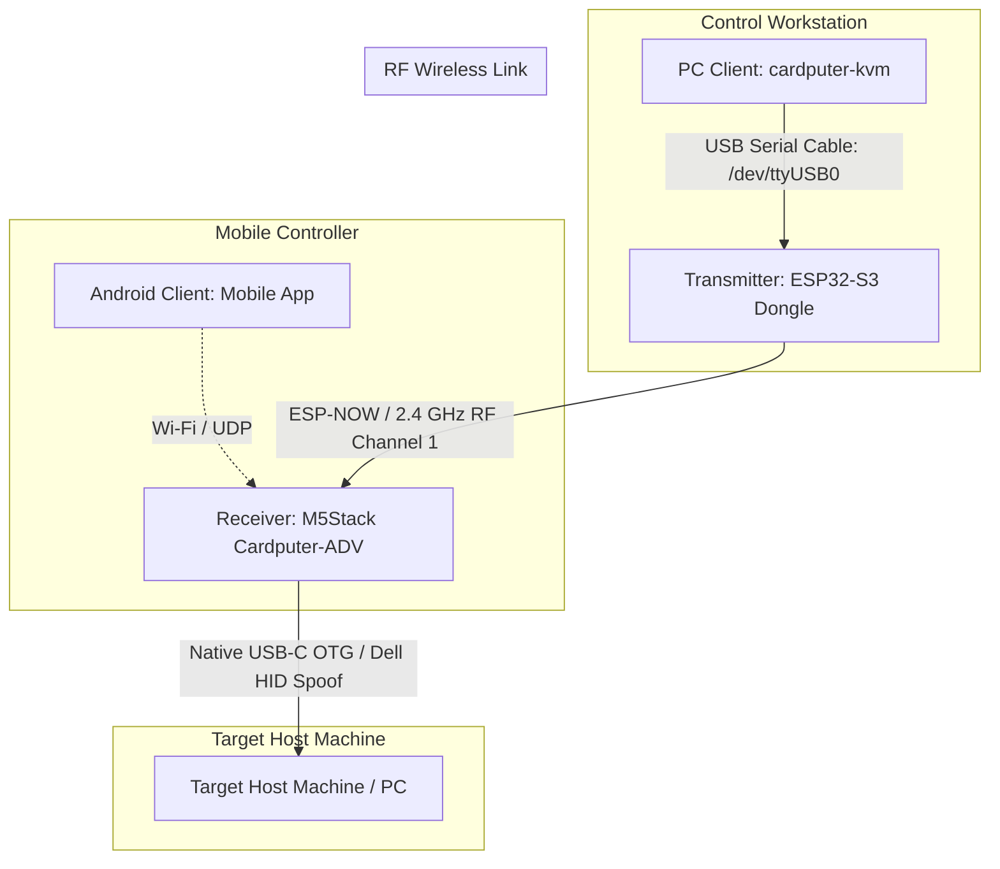

# Cardputer-KVM — System Architecture & Overview

## 1. Project Concept
**Cardputer-KVM** is a modular, wireless/remote KVM (Keyboard-Video-Mouse / Controller) solution where the **M5Stack Cardputer-ADV** serves as the **primary KVM Receiver and Host Interface**, receiving remote input from wireless transmitters, mobile apps, and desktop clients while maintaining local console control.



---

## 2. Directory Structure & Component Roles

| Directory | Target Hardware / Platform | Role & Primary Responsibilities |
| :--- | :--- | :--- |
| **`receiver/`** | **M5Stack Cardputer-ADV** | **Primary Smart KVM Receiver:** Plugs directly into the target host via USB-C. Uses ESP32-S3 native USB OTG to emulate a **Dell KB216 Wired Keyboard + Mouse** (`0x413C:0x2113`). Features a 1.14" ST7789 display for live connection status, battery, and input telemetry, plus local keyboard override. |
| **`transmitter/`** | **ESP32-S3** (N16R8 / Custom) | **Handheld Wireless Transmitter / USB Dongle:** Connects to PC via USB cable (UART bridge). Relays keyboard and mouse packets from the PC client to the Cardputer receiver over **ESP-NOW**. Also functions standalone with onboard buttons. |
| **`pc-client/`** | Desktop OS (Linux / Windows / macOS) | **PC Remote Console (Go TUI):** High-performance Bubbletea TUI application. Communicates directly with the ESP32-S3 transmitter dongle via USB serial to beam raw keystrokes, virtual mouse movements, macros, and scripts. |
| **`android-client/`** | Android Mobile OS | **Mobile Remote Controller:** Touchpad, virtual keyboard, and remote control over Wi-Fi/BLE. |
| **`esp-sdk/`** | Local ESP-IDF Framework | **Toolchain & Core Framework:** Local ESP-IDF v5.3 repository used to build all embedded targets. |

---

## 3. Communication Strategy

### Primary Link: `PC Client` ↔ `Transmitter (ESP32-S3)` ↔ `Receiver (Cardputer-ADV)`
* **Workstation to Transmitter:** USB Serial Cable (`/dev/ttyUSB0` or `/dev/ttyACM0` at 115200 baud). High-speed binary packet framing with auto-port detection.
* **Transmitter to Receiver:** ESP-NOW 2.4 GHz Peer-to-Peer RF (Channel 1, broadcast pairing). Near-zero latency (~2–5 ms), router-free.
* **Receiver to Target Host:** Native USB OTG emulating Dell KB216 Keyboard and Mouse.
* **Secondary / Network Link:** Wi-Fi SoftAP / UDP sockets available for `android-client`.

---

## 4. Hardware Details

### Receiver: `M5Stack Cardputer-ADV`
* **Role:** Smart KVM Receiver, Host USB Injector & On-Desk Status Console.
* **Core:** ESP32-S3FN8 (dual-core 240MHz, 8MB Flash).
* **Native USB Advantage:** USB-C connector is wired **directly to GPIO 19 (D-) and GPIO 20 (D+)**, giving pure USB OTG functionality without intervening bridge chips.
* **USB Identity:** Spoofs a **Dell KB216 Wired Keyboard** (VID: `0x413C`, PID: `0x2113`).
* **Display:** 1.14" ST7789 TFT LCD (240x135 SPI) displaying connection state, battery %, and live input logs.
* **Keyboard:** 56-key matrix scanned by an onboard **TCA8418 I²C controller** (`0x34`, INT on GPIO 11), providing a local physical keyboard override at the host machine.
* **Framework:** M5Stack official HAL (`M5Unified`, `M5GFX`, `Adafruit_TCA8418`, `tusb_hid_device_helper`).

### Transmitter: `ESP32-S3 N16R8`
* **Role:** Remote wireless input transmitter.
* **Core:** ESP32-S3 (dual-core 240MHz).
* **Memory:** 16MB Flash (`DIO 80MHz`) + 8MB Octal PSRAM (`OPI 80MHz`).
* **Input Interfaces:** Onboard BOOT button (GPIO 0), interactive UART0 terminal console bridge, expandable GPIO/ADC headers.
* **Wireless:** ESP-NOW 2.4 GHz RF transmitter (Channel 1, broadcast pairing).

---

## 5. Build Environment Reference

### Activate Local Environment
```bash
. ./esp-sdk/export.sh
```

### Build Receiver (Cardputer-ADV)
```bash
cd receiver
idf.py set-target esp32s3
idf.py build
idf.py -p /dev/ttyACM0 flash monitor
```

### Build Transmitter (ESP32-S3 N16R8)
```bash
cd transmitter
idf.py set-target esp32s3
idf.py build
idf.py -p /dev/ttyUSB0 flash monitor
```

---

## 6. Reference Documentation
* **[`README.md`](file:///media/thunder/LinWin/Projectos/Cardputer-KVM/README.md):** Main project landing page, architecture overview, and quick start guide.
* **[CARDPUTER_ADV_RECEIVER_VERIFICATION.md](file:///media/thunder/LinWin/Projectos/Cardputer-KVM/CARDPUTER_ADV_RECEIVER_VERIFICATION.md):** Verification log, kernel `dmesg` outputs, and HAL integration details.
* **[`receiver/README.md`](file:///media/thunder/LinWin/Projectos/Cardputer-KVM/receiver/README.md):** Receiver firmware details, partition table, and build steps.
* **[`transmitter/README.md`](file:///media/thunder/LinWin/Projectos/Cardputer-KVM/transmitter/README.md):** Transmitter firmware and N16R8 PSRAM configuration.
