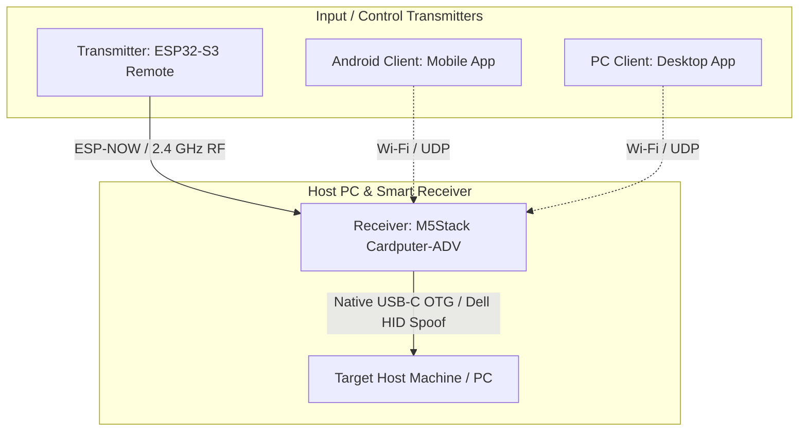

# Cardputer-KVM — System Architecture & Overview

## 1. Project Concept
**Cardputer-KVM** is a modular, wireless/remote KVM (Keyboard-Video-Mouse / Controller) solution where the **M5Stack Cardputer-ADV** serves as the **primary KVM Receiver and Host Interface**, receiving remote input from wireless transmitters, mobile apps, and desktop clients while maintaining local console control.



---

## 2. Directory Structure & Component Roles

| Directory | Target Hardware / Platform | Role & Primary Responsibilities |
| :--- | :--- | :--- |
| **`receiver/`** | **M5Stack Cardputer-ADV** | **Primary Smart KVM Receiver:** Plugs directly into the target host via USB-C. Uses ESP32-S3 native USB OTG to emulate a **Dell KB216 Wired Keyboard** (`0x413C:0x2113`). Features a 1.14" ST7789 display for live connection status, battery, and input telemetry, plus local keyboard override. |
| **`transmitter/`** | **ESP32-S3** (Remote / Uno / Custom) | **Handheld Wireless Transmitter:** Captures user keystrokes / controls and transmits low-latency packets to the Cardputer-ADV receiver via **ESP-NOW**. |
| **`pc-client/`** | Desktop OS (Linux / Windows) | **PC Remote Console:** Companion desktop app to send keystrokes, shortcuts, and macros over the network to the Cardputer receiver. |
| **`android-client/`** | Android Mobile OS | **Mobile Remote Controller:** Touchpad, virtual keyboard, and remote control over Wi-Fi/BLE. |
| **`esp-sdk/`** | Local ESP-IDF Framework | **Toolchain & Core Framework:** Local ESP-IDF v5.3 repository used to build all embedded targets. |

---

## 3. Communication Strategy

### Primary Link: `Transmitter` ↔ `Receiver (Cardputer-ADV)`
* **Protocol: ESP-NOW (2.4 GHz Peer-to-Peer RF)**
  * Router-free, connectionless direct RF packets between Transmitter and Cardputer-ADV.
  * Near-zero latency (~2–5 ms), ideal for seamless typing, key holds, and combinations.
  * Encryption available via PMK/LMK pairing.
* **Secondary / Network Link:** Wi-Fi SoftAP / UDP sockets for `android-client` and `pc-client`.

---

## 4. Hardware Details

### Receiver: `M5Stack Cardputer-ADV`
* **Role:** Smart KVM Receiver, Host USB Injector & On-Desk Status Console.
* **Core:** ESP32-S3FN8 (dual-core 240MHz, 8MB Flash).
* **Native USB Advantage:** USB-C connector is wired **directly to GPIO 19 (D-) and GPIO 20 (D+)**, giving pure USB OTG functionality without intervening bridge chips.
* **USB Identity:** Spoofs a **Dell KB216 Wired Keyboard** (VID: `0x413C`, PID: `0x2113`).
* **Display:** 1.14" ST7789 TFT LCD (240x135 SPI) displaying connection state, battery %, and live input logs.
* **Keyboard:** 56-key matrix scanned by an onboard **TCA8418 I²C controller** (`0x34`, INT on GPIO 11), providing a local physical keyboard override at the host machine.
* **Framework:** M5Stack official HAL (`M5Unified`, `M5GFX`, `Adafruit_TCA8418`, `tusb_hid_device_helper`).

### Transmitter: `ESP32-S3 Remote`
* **Role:** Remote handheld input device.
* **Core:** ESP32-S3 (Uno board, custom keypad, or handheld controller).
* **Wireless:** ESP-NOW transmitter emitting keycode events to the Cardputer-ADV MAC address.

---

## 5. Build Environment Reference

### Activate Local Environment
```bash
. ./esp-sdk/export.sh
```

### Build Receiver (Cardputer-ADV)
```bash
cd receiver
idf.py set-target esp32s3
idf.py build
idf.py -p /dev/ttyACM0 flash monitor
```

### Build Transmitter
```bash
cd transmitter
idf.py set-target esp32s3
idf.py build
```

---

## 6. Reference Documentation
* **[CARDPUTER_ADV_RECEIVER_VERIFICATION.md](file:///media/thunder/LinWin/Projectos/Cardputer-KVM/CARDPUTER_ADV_RECEIVER_VERIFICATION.md):** Verification log, kernel `dmesg` outputs, and HAL integration details.
* **[`receiver/README.md`](file:///media/thunder/LinWin/Projectos/Cardputer-KVM/receiver/README.md):** Build, flash, and test instructions for the Cardputer-ADV receiver firmware.
