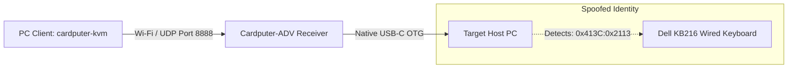

# Cardputer-KVM — PC Client (Go TUI)

A high-performance, single-binary Terminal User Interface (TUI) client written in **Go** using [Bubbletea](https://github.com/charmbracelet/bubbletea) and [Lipgloss](https://github.com/charmbracelet/lipgloss).

The PC Client allows any Linux, macOS, or Windows machine to act as a wireless remote KVM controller, transmitting low-latency keystrokes, macros, and script injections over Wi-Fi / UDP directly to the **M5Stack Cardputer-ADV Receiver** plugged into the target host machine.

---

## 1. Key Features

- **Single Standalone Binary:** Zero runtime dependencies or interpreters; compiles into an ultra-compact (~4–6 MB) executable.
- **Cyberpunk / Slate TUI Aesthetics:** Rich truecolor terminal interface featuring glowing status badges, active key HUDs, and real-time telemetry.
- **4 Operational Modes:**
  1. **`[1] LIVE CAPTURE (Raw KVM)`**: Captures all keypresses in the terminal (functional keys F1–F12, arrows, backspace, modifiers) and beams standard 6KRO USB HID packets to the Cardputer.
  2. **`[2] MACRO DECK`**: One-touch shortcuts for tricky remote combinations:
     - `[1]` `Ctrl+Alt+Del` (Windows Security / Sign-out / Task Manager)
     - `[2]` `Alt+Tab` (Window Switcher)
     - `[3]` `Win+R` (Run Dialog)
     - `[4]` `Win+X` (Power User / Admin Menu)
     - `[5]` `Ctrl+Shift+Esc` (Task Manager)
     - `[6]` `Alt+F4` (Close Active Window)
     - `[7]` `Win+L` (Workstation Lock)
     - `[8]` `PrtScn` (Screenshot)
     - `[9]` `Win+D` (Show Desktop)
     - `[0]` `Win+E` (File Explorer)
     - `[c]` `Ctrl+C` / `[v]` `Ctrl+V` (Copy / Paste)
  3. **`[3] TEXT INJECTOR`**: Input / paste multi-line commands, URLs, or shell scripts and stream them character-by-character into the target host at configurable speed (default 15ms delay).
  4. **`[4] TELEMETRY`**: Real-time packet counters, payload size, latency tracking, socket error monitors, and manual heartbeat ping trigger.
- **Non-Interactive CLI Mode:** Run single commands directly from bash scripts or automation pipelines without opening the TUI:
  ```bash
  ./cardputer-kvm -text "sudo apt update && sudo apt upgrade -y"
  ./cardputer-kvm -macro cad
  ```

---

## 2. Architecture & Wire Protocol



The wire protocol uses a packed binary format matching `kvm_protocol.h`:
- **Magic:** `0x4B56` (`"KV"`, little-endian)
- **Key Report Packet (`0x01`):** 12 bytes (`Magic`, `Type`, `Modifiers bitmask`, `6x HID Keycodes`, `Sequence Number`).
- **Heartbeat Packet (`0x03`):** 9 bytes (`Magic`, `Type`, `Uptime timestamp`, `Sequence Number`).

---

## 3. Installation & Compilation

### Prerequisites
- **Go 1.21+** (Tested on Go 1.27.1 on Arch Linux / CachyOS).

### Build Binary
```bash
cd pc-client
go build -ldflags="-s -w" -o cardputer-kvm
```
This produces an optimized standalone binary: `cardputer-kvm`.

---

## 4. Usage

### Launch Interactive TUI
Connect to the default Cardputer-ADV SoftAP (`Cardputer-KVM` at `192.168.4.1:8888`):
```bash
./cardputer-kvm
```

Target a custom IP on your local LAN or office network:
```bash
./cardputer-kvm -target 192.168.1.120 -port 8888
```

### TUI Navigation Controls
| Key | Action |
| :--- | :--- |
| **`Esc`** or **`Ctrl+Q`** | Release / Pause Live Capture mode |
| **`Space`** | Resume Live Capture mode |
| **`Tab`** / **`Shift+Tab`** | Switch between Modes (Live Capture / Macros / Text / Telemetry) |
| **`1` – `4`** | Jump directly to Tab 1, 2, 3, or 4 |
| **`q`** | Quit application (when outside capture mode) |

### CLI One-Shot Automation
Send text without opening the TUI:
```bash
./cardputer-kvm -target 192.168.4.1 -text "git status\n"
```

Trigger `Ctrl+Alt+Del`:
```bash
./cardputer-kvm -target 192.168.4.1 -macro cad
```

Trigger `Win+L` (Workstation lock):
```bash
./cardputer-kvm -target 192.168.4.1 -macro lock
```

---

## 5. Development & Project Structure

```text
pc-client/
├── go.mod                     # Go module definitions
├── go.sum                     # Checksums
├── main.go                    # Entry point & CLI flag parser
├── pkg/
│   ├── protocol/
│   │   └── protocol.go        # Protocol packing, HID key table & conversions
│   ├── transport/
│   │   └── transport.go       # UDP socket client & telemetry tracker
│   └── ui/
│       ├── styles.go          # Lipgloss palette & cyber/slate theme
│       └── ui.go              # Bubbletea Elm model, view renderers & event loop
└── README.md                  # This documentation
```
