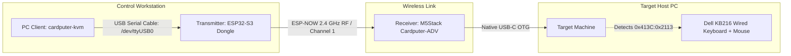

# Cardputer-KVM — PC Client (Go TUI)

A high-performance, single-binary Terminal User Interface (TUI) client written in **Go** using [Bubbletea](https://github.com/charmbracelet/bubbletea) and [Lipgloss](https://github.com/charmbracelet/lipgloss).

The PC Client turns your workstation into a remote KVM station: it communicates directly over **USB Serial** with an **ESP32-S3 Transmitter Dongle** plugged into your PC. The transmitter then beams all keyboard and mouse packets over **ESP-NOW (2.4 GHz RF)** to the **M5Stack Cardputer-ADV Receiver** plugged into the target host computer.

---

## 1. System Architecture



- **Zero Network Setup:** No Wi-Fi routers, no IP addresses, no DHCP. Plug in the ESP32-S3 transmitter via USB cable, launch the client, and start typing.
- **Ultra-Low Latency:** Direct UART connection (115200 baud) + connectionless 2.4 GHz ESP-NOW frames (~2–5 ms round-trip).

---

## 2. Key Features

- **Single Standalone Binary:** Zero runtime dependencies or interpreters; compiles into an ultra-compact **4.0MB static binary**.
- **Auto-Detection:** Automatically discovers plugged-in ESP32-S3 boards on `/dev/ttyUSB*` (CH340) or `/dev/ttyACM*` (Native USB).
- **Cyberpunk / Slate TUI Aesthetics:** Rich truecolor terminal interface featuring glowing status badges, active key HUDs, and real-time telemetry.
- **5 Operational Modes:**
  1. **`[1] KEYBOARD CAPTURE`**: Captures every keypress in the terminal (functional keys F1–F12, arrows, backspace, modifiers) and beams standard 6KRO USB HID packets. Features an escape hatch (`Esc` or `Ctrl+Q` to pause capture).
  2. **`[2] MOUSE TRACKPAD`**: Control remote mouse cursor directly from terminal using arrow keys / `h-j-k-l`, with click buttons (`Space`/`Enter` for Left Click, `r` for Right Click, `m` for Middle Click) and scroll wheel (`w`/`s`). Hold `Alt` for 3x turbo cursor speed.
  3. **`[3] MACRO DECK`**: One-touch system shortcuts:
     - `[1]` `Ctrl+Alt+Del` (Windows Security / Sign-out / Task Manager)
     - `[2]` `Alt+Tab` (Window Switcher)
     - `[3]` `Win+R` (Run Dialog)
     - `[4]` `Win+X` (Power User / Admin Menu)
     - `[5]` `Ctrl+Shift+Esc` (Task Manager)
     - `[6]` `Alt+F4` (Close Active Window)
     - `[7]` `Win+L` (Workstation Lock)
     - `[8]` `PrtScn` (Screenshot)
     - `[9]` `Win+D` (Show Desktop)
     - `[0]` `Win+E` (File Explorer)
     - `[c]` `Ctrl+C` / `[v]` `Ctrl+V` (Copy / Paste)
  4. **`[4] TEXT INJECTOR`**: Input / paste multi-line commands, URLs, or shell scripts and stream them character-by-character into the target host at configurable speed (default 15ms delay).
  5. **`[5] TELEMETRY`**: Real-time packet counters, payload size, latency tracking, IO error monitors, and manual heartbeat ping trigger.
- **Non-Interactive CLI Mode:** Run single commands directly from bash scripts or automation pipelines without opening the TUI:
  ```bash
  ./cardputer-kvm -text "sudo apt update && sudo apt upgrade -y"
  ./cardputer-kvm -macro cad
  ./cardputer-kvm -macro lock
  ```

---

## 3. Installation & Compilation

### Prerequisites
- **Go 1.21+** (Tested on Go 1.27.1 on Arch Linux / CachyOS).

### Build Binary
```bash
cd pc-client
make        # builds optimized stripped binary 'cardputer-kvm'
```

---

## 4. Usage

### Launch Interactive TUI (Auto-detects USB Serial Port)
```bash
./cardputer-kvm
```

### Specify a Custom Serial Port
```bash
./cardputer-kvm -serial /dev/ttyUSB0
```

### TUI Navigation Controls
| Key | Action |
| :--- | :--- |
| **`Esc`** or **`Ctrl+Q`** | Pause / Release Keyboard Capture mode |
| **`Space`** | Resume Keyboard Capture mode (in Tab 1) |
| **`Tab`** / **`Shift+Tab`** | Switch between Modes (Keyboard / Mouse / Macros / Text / Telemetry) |
| **`1` – `5`** | Jump directly to Tab 1, 2, 3, 4, or 5 |
| **`q`** | Quit application (when outside capture mode) |

### CLI One-Shot Automation
Send text without opening the TUI:
```bash
./cardputer-kvm -text "git status\n"
```

Trigger `Ctrl+Alt+Del`:
```bash
./cardputer-kvm -macro cad
```

Trigger `Win+L` (Workstation lock):
```bash
./cardputer-kvm -macro lock
```

---

## 5. Development & Project Structure

```text
pc-client/
├── Makefile                   # Build, run, tidy helpers
├── go.mod                     # Go module definitions
├── go.sum                     # Checksums
├── main.go                    # Entry point & CLI flag parser
├── pkg/
│   ├── protocol/
│   │   └── protocol.go        # Protocol packing, HID key/mouse table & conversions
│   ├── transport/
│   │   └── transport.go       # Serial dongle client & telemetry tracker
│   └── ui/
│       ├── styles.go          # Lipgloss palette & cyber/slate theme
│       └── ui.go              # Bubbletea Elm model, view renderers & event loop
└── README.md                  # This documentation
```
